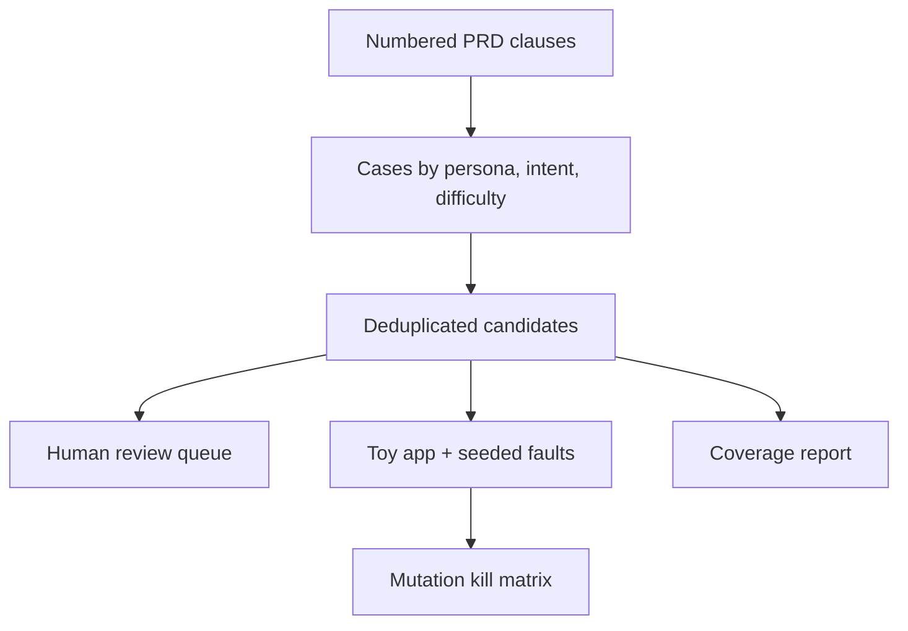

# Requirements-Traced Test Generator

[](https://github.com/MadanMohan0537/requirements-traced-test-generator/actions/workflows/ci.yml)

**Turn numbered PRD requirements into happy-path, boundary, and hostile test cases that each trace back to a clause, then check which seeded defects the suite actually catches.**

Python 3.11+ package with no third-party runtime dependencies. The installable package and the CLI are still named `casefoundry` (`casefoundry = casefoundry.cli:main` in `pyproject.toml`).

## Problem and who it's for

Hand-written golden test sets lean toward happy paths and go stale as requirements change. Generating more test text does not prove better coverage: ten paraphrases can all miss the same authorization bug. PMs who write PRDs, QA and evaluation engineers, and teams building AI assistants need tests that stay tied to a requirement and can be checked against defects.

## Approach

1. Parse Markdown requirements written as `[R1] requirement text` (one clause per line; a leading `-` or `*` is allowed).
2. For each requirement, emit a fixed, deterministic set of cases. Each case is labeled with a persona, an intent, and a difficulty (`happy`, `boundary`, or `hostile`). Every case keeps `requirement_id`, the source clause in `evidence`, and generator version `deterministic-grid-v1`. This is not a full cross product of persona, intent, and difficulty.
3. Drop a later case only when it shares the requirement id and expected value with an earlier case and the token-set Jaccard similarity of the two inputs is at least 0.92.
4. Insert every candidate into a SQLite review queue with status `pending`. A reviewer can later set `accepted`, `edited`, or `rejected`. Nothing is promoted to a trusted golden set automatically.
5. **Mutation adequacy:** run the executable cases against a toy app with four seeded faults, and write a case-to-mutation kill matrix (case ids), plus per-requirement coverage. A requirement is flagged `thin` when it has fewer than 3 cases.



## What exists today

On `data/sample-prd.md`, `casefoundry generate` reports:

- 5 requirements, covering upload limits, grounding, refusal, and deletion.
- **16 cases**: 5 happy, 6 boundary, 5 hostile. Counts by requirement are R1: 4, R2: 3, R3: 3, R4: 3, R5: 3. None are `thin`. The Jaccard step does not drop any sample case.
- **4/4 seeded mutations killed**, with an empty survivor list: `oversize_allowed`, `unsafe_extension_allowed`, `role_check_removed`, and `unsupported_answered`. `tests/test_mutations.py` also asserts that a happy-path-only subset scores below 1.0.
- A fresh `reviews.db` stores all 16 cases as `pending` (`queued_for_review` is 16 on that first insert).
- `cases.json` (the cases) and `coverage.json` (requirement counts, the `thin` flag, difficulty counts, mutation score, survivors, and the case ids that killed each mutation). The review count is printed by the CLI; it is not a field in `coverage.json`.

`python -m unittest discover -s tests -v` runs **13** tests. `.github/workflows/ci.yml` runs that command on Python 3.11, 3.12, and 3.13.

Recognized templates are only R1–R5. Any other id still gets three traceable cases whose expected value is `manual-review`.

## How success would be measured

| Measure | Status |
|---|---|
| Mutation score on seeded faults | The bundled suite reports 4/4 killed (`score` 1.0) on the toy app. Tests lock that result. It means this suite killed these four mutations. |
| Requirements with too few cases | Reported per requirement as `thin` when the case count is below 3. None are thin on the sample. |
| Reviewer acceptance rate of generated cases | Not yet measured |
| Defects found per 100 cases on incident-derived faults | Not yet measured |

## Limitations

- The parser needs explicit `[R#]` ids, one clause per line. It is not a general natural-language PRD parser.
- Executable expectations are templates for the bundled toy app and only recognize R1–R5. Other requirements get traceable `manual-review` cases.
- Token-set deduplication misses semantic paraphrases. It only compares cases that already share a requirement id and an expected value.
- The four seeded mutations are controlled stand-ins in `casefoundry/mutations.py`.
- The review queue is a local SQLite file. It has no authentication, assignment, audit signatures, or web UI.
- Semantic clause extraction, calibrated semantic deduplication, and the items in [docs/BACKLOG.md](docs/BACKLOG.md) (starting with the oracle uncertainty queue) are planned, not shipped. This package does not call a model.
- Generated expected behavior can be confidently wrong. Review cases before treating them as trusted, and do not use these synthetic tests as the only release gate for safety-critical decisions.

See [docs/ARCHITECTURE.md](docs/ARCHITECTURE.md) and [docs/BACKLOG.md](docs/BACKLOG.md).

## Quick start

Requires Python 3.11+. No API key, model download, or account. The tool itself makes no network calls. If `python` is not on your PATH, use `python3` for the `venv` line; after activation, `python` is the virtualenv interpreter.

```bash
git clone https://github.com/MadanMohan0537/requirements-traced-test-generator.git
cd requirements-traced-test-generator
python -m venv .venv
source .venv/bin/activate
python -m pip install -e .
python -m unittest discover -s tests -v
casefoundry generate data/sample-prd.md --output cases.json --report coverage.json --review-db reviews.db
```

## Deployment

Cloudflare Workers is the planned target. This repository is not deployed, and Workers is not configured yet: there is no `wrangler.toml`, no Worker entry point, and no Workers package.

Madan deploys with Cloudflare Workers. Once the pieces below exist, the deploy command is:

```bash
npx wrangler deploy
```

Still needed before that command can deploy this project:

- `wrangler.toml`
- a Worker entry point
- Python Workers, or a JavaScript/TypeScript port of the `casefoundry` package

## License

MIT. See [LICENSE](LICENSE).
